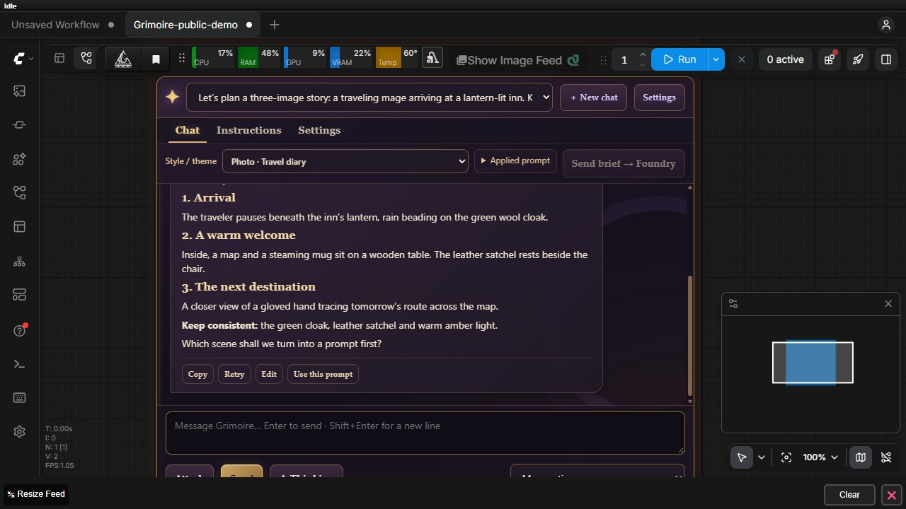

# Prompt Mage Studio · local beta

Independent Grimoire, Foundry, Archmage, Spell Scroll, Appearance Overrides, Resolution and image upload nodes. DART tag nodes remain in the original Prompt Mage package.

## Grimoire · your creative spellbook

Plan scenes in a saved conversation, refine the details, then apply the reply you want to use. Grimoire includes Markdown messages, style presets, image/file attachments, optional thinking, and copy/edit/retry controls. System instructions, project instructions and pinned facts have separate fields.



*Captured in ComfyUI using an authored demo conversation for interface illustration. No private chats or API keys are shown. Click an image to view it at full size.*

<details>
<summary>Full Grimoire node, sockets and chat controls</summary>


</details>

Use **Use this prompt** to apply a reply to Spell Scroll. To turn an agreed project into a production plan, connect **production_brief** to Foundry and choose **Send brief → Foundry**. Chatting alone does not start image generation.

## Status

Real ComfyUI CPU startup with both packs installed passed: 13 Studio and 32 original node registrations, with separate API namespaces responding. Additional browser and native GPU chat checks passed on 2026-11-18; see TESTING.md for exact coverage and remaining limits. This beta is not published to Comfy Registry.

## Installation

Clone the separate repository inside your ComfyUI `custom_nodes` directory:

```sh
git clone https://github.com/Renz1998/ComfyUI-Prompt-Mage-Studio.git
```

Using the Python environment that runs ComfyUI, install `requirements.txt` from the cloned folder. Restart ComfyUI when idle and refresh the browser. Keep the [original Prompt Mage pack](https://github.com/Renz1998/ComfyUI-Prompt-Mage) installed for old workflows and DART tools. Studio display names begin Prompt Mage Studio. If you installed the beta ZIP already, keep that folder as a backup outside `custom_nodes` before cloning; do not install two Studio copies.

Start with workflows/grimoire-to-foundry.json. Select your installed model filenames. Models are reused from ComfyUI; no weights or keys are included. Local Qwen is the default, with optional API providers and independent review model selection.

## Copy existing data and workflows

Run tools/migrate.py using the ComfyUI Python environment with --user-directory pointing to your real ComfyUI user directory. The default is a dry run. Add --apply to copy missing records and create separate Studio workflow files. Add --include-keys only if you also want to copy provider credentials on this trusted machine. Originals are retained and existing destination files are skipped. Back up your user directory first. Closed/idle ComfyUI is recommended for a consistent snapshot.

Studio uses prompt_mage_studio for saved chats, keys, briefs and runs. Workflows receive new node IDs only for Studio-owned types; DART nodes stay unchanged and need the original pack. Local paths in historical workflows may still need manual adjustment when transferring to another machine.

## Packaging

Repository: [Renz1998/ComfyUI-Prompt-Mage-Studio](https://github.com/Renz1998/ComfyUI-Prompt-Mage-Studio). Registry ID proposed: prompt-mage-studio; publisher: renz1998. Registry publication remains pending. GitHub availability does not imply a Comfy Registry listing. The existing package and its Registry listing are unchanged. See LICENSE and CREDITS.md for upstream attribution, including the original ComfyUI-Dart creators.
