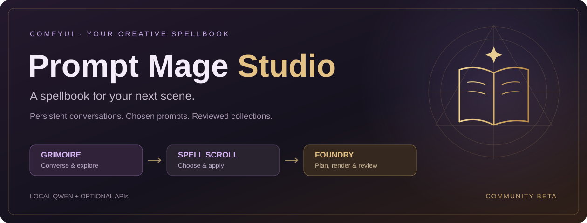
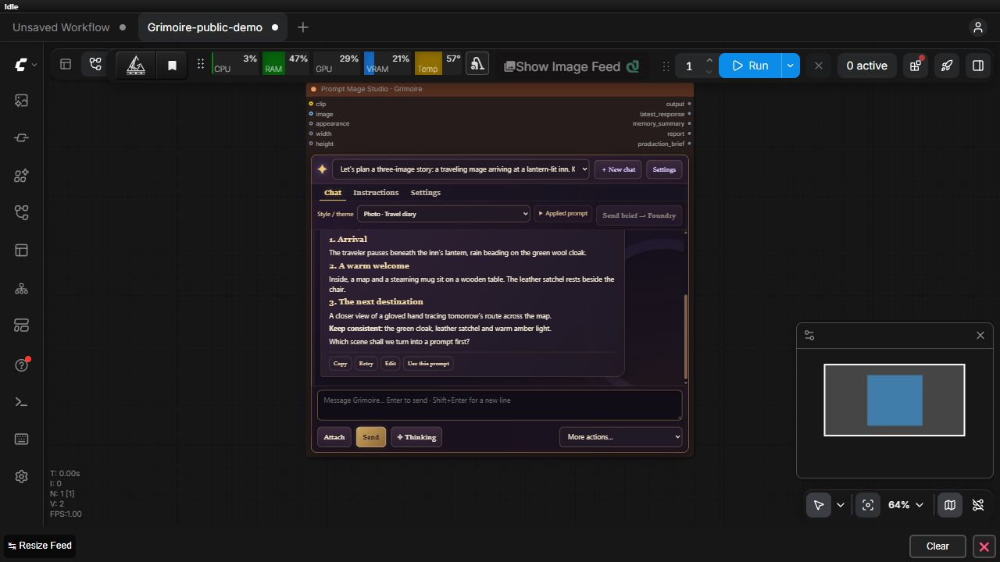

# Prompt Mage Studio for ComfyUI

**Talk through an idea. Choose your prompt. Forge a collection.**

Grimoire brings persistent, reference-aware conversations into ComfyUI. Refine a scene with your assistant, apply your favorite reply, or hand an agreed brief to Foundry to plan, render and review a series of images. Shared appearance recipes and visual styles keep your creative direction close at hand.

[Quickstart](QUICKSTART.md) · [Workflows](workflows/README.md) · [Migration](docs/MIGRATION.md) · [Testing & limits](TESTING.md) · [Community](https://github.com/Renz1998/ComfyUI-Prompt-Mage-Studio/issues) · [Support](#help-build-the-studio) · [Credits](CREDITS.md)

**Public beta · Foundry is experimental · Comfy Registry publication pending.** Install from GitHub for now. DART tag tools remain in [the original Prompt Mage](https://github.com/Renz1998/ComfyUI-Prompt-Mage).

## Meet Grimoire, your creative spellbook


*Real ComfyUI interface with an authored demo conversation. No private chats or API keys are shown. Open either screenshot to see it at full size.*

- **Keep the conversation.** Saved chats, pinned facts and conversation compaction help carry a project across sessions.
- **Bring references.** Drop images and files into chat, or connect image inputs. Reuse an Appearance Overrides recipe for your subject.
- **Find the look.** Choose photographic, illustration and anime styles, add your own notes, and change direction as you chat.
- **Use familiar chat controls.** Markdown, code blocks, copy, edit and retry sit beside your messages. Optional thinking is available with compatible models.
- **Decide what gets generated.** Apply a reply with **Use this prompt**. Further conversation does not silently replace that selection.

<details>
<summary><strong>See the full Grimoire node and connections</strong></summary>



</details>

## From a conversation to a collection

**Grimoire → Spell Scroll → your image workflow**

Chat freely, choose **Use this prompt**, then generate with the applied snapshot. Normal workflow runs reuse that prompt without making another chat request.

**Grimoire → production brief → Foundry → render & review**

Agree on a project in chat, then choose **Send brief → Foundry** with the dedicated connection in place. Review the plan before approving it. In automatic mode, Foundry renders, reviews, retries when needed and advances when a frame passes the configured checks. Manual controls remain available.

Foundry includes reference images, style choices, IG carousel and other script templates, adjustable passing scores, anatomy and scene-cohesion checks, and readable collection folders. Choose a separate image-review model when you want a different assistant to assess the results.

**Review scores are assistant judgments, not guarantees.** Inspect accepted images before posting. Retry and API-call caps bound a run; they do not promise a price or perfect output.

## Install

Run these commands from your ComfyUI folder. Use the **Python environment that runs ComfyUI** for the final command:

```sh
cd custom_nodes
git clone https://github.com/Renz1998/ComfyUI-Prompt-Mage-Studio.git
python -m pip install -r ComfyUI-Prompt-Mage-Studio/requirements.txt
```

Restart ComfyUI when idle, refresh your browser, and search **Prompt Mage Studio** or **Grimoire**. [Windows portable setup →](QUICKSTART.md)

Keep the original Prompt Mage pack for existing workflows and DART tools. Studio has separate node IDs and storage, so both packs can coexist. If you installed the Studio beta ZIP, move that copy outside `custom_nodes` before cloning to avoid duplicate Studio installations.

## Pick your starting point

| You want to… | Start here |
| --- | --- |
| Discuss a scene and choose a prompt | **Grimoire + Spell Scroll** |
| Turn a conversation into a collection | [Grimoire → Foundry workflow](workflows/grimoire-to-foundry.json) |
| Test rendering and review on one frame | [Single-frame Foundry workflow](workflows/experimental/01-foundry-single-frame-moss.json) |
| Compose directly from text or a reference | **Archmage** |
| Reuse a subject's appearance in prompts | **Appearance Overrides** |
| Share one canvas size across the graph | **Resolution**, including 4:5 |
| Upload local files or a folder to the server | **Upload Images** |

[Workflow setup and requirements →](workflows/README.md)

The production examples target **MOSS Image**, use **Local Qwen** by default and include no character LoRA. Select your installed model filenames and install the workflow's required nodes before running. Weights and API keys are not bundled.

## Choose your assistant

| Option | What you need |
| --- | --- |
| **Local Qwen** | A compatible generation-capable model; vision weights for image references |
| **OpenAI API** | A provider key entered through the node's masked key panel |
| **DeepSeek API** | A key and a model supporting your intended inputs |
| **Venice API** | A Venice key; **DeepSeek V4.1 Flash 1017 Uncensored** is recommended for chat and images. [Setup →](docs/VENICE_API.md) |
| **Gemini API** | A key and a compatible model |

Venice is supported in Grimoire, Archmage, Foundry planning and image review. Its “Uncensored” label is the provider’s model name; API usage is subject to account access and billing.

Provider choices depend on the node. Foundry lets you choose its production assistant and reviewer separately. API use is billed by the provider; thinking and visual review can increase latency and token use.

Keys are saved separately in the ComfyUI server's user directory, outside workflow JSON. Chats and memory also live on that server. Use trusted hosting and persistent storage on a pod. Attachments and API requests may send material to your selected provider.

Model sources: [Qwen checkpoints](https://huggingface.co/Qwen) · [MOSS Image and its guide](https://github.com/OpenMOSS/MOSS-Image). Use the exact checkpoint required by your workflow. A text-only or stripped encoder may not support chat or vision generation.

## Already using Prompt Mage?

Studio includes a **dry-run-first migration tool** to copy saved data and create separate workflow copies. Originals are preserved, existing destinations are skipped, and credential copying is opt-in.

[Copy chats, runs and workflows →](docs/MIGRATION.md)

## Beta status and practical limits

Local checks covered both packs installed together, browser controls, Grimoire GPU chat and focused Grimoire/Foundry tests. [Read the validation record](TESTING.md) for exact coverage.

- The supplied Foundry workflows compose MOSS prompts; support for every image model or graph is not implied.
- Valid JSON and bounding boxes do not guarantee exact diffusion placement or anatomical accuracy.
- Appearance Overrides changes descriptions; it does not load a character LoRA or edit pixels.
- RunPod deployment has not been validated for this beta. Model paths, dependencies and persistent storage need setup on each server.
- Proposed Registry ID: `prompt-mage-studio`. Publication remains pending.

## Help build the Studio

Have a useful workflow, a confusing control or a reproducible bug? **[Share it on GitHub](https://github.com/Renz1998/ComfyUI-Prompt-Mage-Studio/issues/new)**. Include your models, settings and reproduction steps. Remove keys and private chats before sharing logs or screenshots.

If Studio helps your work, a star or optional contribution supports development:

**[☕ Ko-fi](https://ko-fi.com/renzuwu)** · **[PayPal](https://paypal.me/luckyrenz1998)**

<details>
<summary>Support with USDT · TRON / TRC20</summary>

Use the code block's copy button. Check the TRON network before sending.

```text
TUggk9S4aDDyT7HxrEjqCDxFPXgEr4okW8
```

</details>

## Credits

Prompt Mage Studio is maintained by [Renz1998](https://github.com/Renz1998). It includes Grimoire, Foundry and scene-assistance tools. **DART tag nodes and DART models are not included or required.** They are available separately in the [original Prompt Mage pack](https://github.com/Renz1998/ComfyUI-Prompt-Mage).

Studio's code lineage includes nkchocoai/ComfyUI-Dart and its contributors. This is source-code attribution, not a DART feature or dependency. Qwen, OpenMOSS, Hugging Face and ComfyUI retain credit for their models, formats and runtime.

[Full credits and source history](CREDITS.md) · [GPL-3.0 license](LICENSE)
