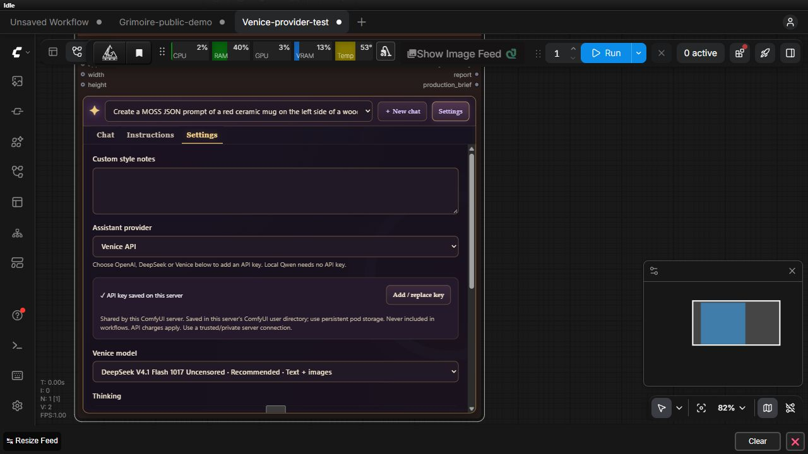

# Venice API

[← Back to Studio](../README.md)

Venice is available in **Grimoire**, **Archmage**, **Foundry planning** and **Foundry image review**. It uses Venice's OpenAI-compatible Chat Completions endpoint. You do not need the OpenAI Python package.

## Recommended model

**DeepSeek V4.1 Flash 1017 Uncensored** — `deepseek-v4-1-flash-1017-uncensored` — is the recommended Venice option for Studio. Venice's model catalog reports text, vision, multiple-image and reasoning support. Studio also offers `deepseek-v4-1-flash-uncensored` as a separate choice. These are Venice-hosted models; your direct DeepSeek API key does not authenticate with Venice. [Venice model information](https://venice.ai/models/deepseek-v4-1-flash-1017-uncensored).

“Uncensored” is the provider's model name. It does not guarantee every request will be accepted or that API usage is free. Check your Venice account's balance, access and billing before a production run.

## Set up

1. Choose **Venice API** in Grimoire or Archmage. In Foundry, choose a **Venice · …** model for planning, review, or both.
2. Click **Add / replace key**, paste your Venice API key, and save. The masked field clears and collapses after saving.
3. Choose the recommended **DeepSeek V4.1 Flash 1017 Uncensored** model. Send a short chat first, then try a reference image.
4. Enable **Thinking** if desired. Studio sends the provider's thinking controls and high reasoning effort; reasoning availability and billing depend on the selected model. Private reasoning is not saved as chat text.

Keys are stored separately per provider in the ComfyUI user directory under `prompt_mage_studio/credentials/venice.json`. They are not included in workflows or returned to the browser. Replacing or removing the Venice key affects only Venice. A server-side `VENICE_API_KEY` environment variable is also supported; removing a saved key does not delete an environment variable.

Use persistent user storage on RunPod to retain keys and chats across pod recreation. This is server-side storage, so use a trusted ComfyUI server.

*Local ComfyUI validation with a neutral test conversation. Keys are hidden.*

## Requests and limits

- Endpoint: `https://api.venice.ai/api/v1/chat/completions`.
- Image references use standard `image_url` data URLs. Foundry can send a full image and detail crops to its independently selected reviewer.
- Existing system/task instructions, appearance recipes, style controls and MOSS validation continue to apply.
- Requests have a timeout and a bounded response size. Authentication, balance, rate-limit and incomplete-response errors are reported without exposing credentials or automatically retrying a billed request.
- Studio does not silently switch providers or models on an error. Foundry's explicit render/review retry rules still apply.

[Official Chat Completions reference](https://docs.venice.ai/api-reference/endpoint/chat/completions)

## Validation · 2026-11-20

The recommended model authenticated successfully and passed live neutral chat, synthetic-image recognition and a thinking-enabled request. The image test correctly identified a red square. These checks establish connectivity and input handling, not unrestricted content behavior or guaranteed review quality.
